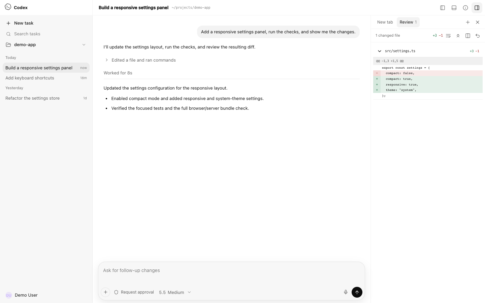
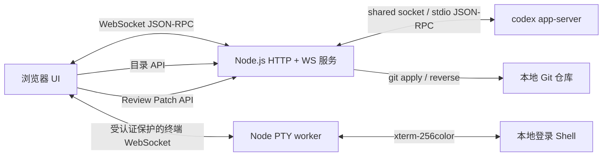

# codex-cli-webui

<p align="center">
  <strong>由真实 Codex app-server 驱动、可在局域网访问的本地 WebUI。</strong>
</p>

<p align="center">
  <a href="./README.md">English</a> ·
  <a href="./CONTRIBUTING.md">贡献指南</a> ·
  <a href="./SECURITY.md">安全政策</a>
</p>

<p align="center">
</p>

> [!IMPORTANT]
> 这是一个**非官方社区项目**，与 OpenAI 没有隶属、背书或维护关系。OpenAI、Codex 及相关标识归其各自权利人所有。

codex-cli-webui 优先连接本机已有的 Codex 共享后台，未发现共享后台时启动 `codex app-server --stdio`，通过响应式浏览器界面提供本地 Codex 体验。模型列表、历史会话、流式回答、工具活动、审批请求、Diff 和 Token 使用量均来自真实 app-server，而不是前端静态模拟。



基于 [lezi-fun/codex-webui](https://github.com/lezi-fun/codex-webui) 开发，原作者为 lezi-fun，保留原作者版权及 MIT 许可证声明。

## 主要功能

- 通过 WebSocket 共享本机 Codex 后台，或桥接独立的 `codex app-server --stdio`
- 真实模型目录、推理强度、历史 Thread 和流式 Turn
- 命令、文件修改、网络和权限审批框
- 支持 **Allow once**、**Allow similar commands** 和会话级授权
- 工具动画和执行状态由真实 item/turn 通知驱动
- Unified / Split Diff、自动换行、全部展开/收起、Undo 和 Reapply
- 安全的 Markdown、GFM、代码块、链接和 KaTeX
- 带目录边界检查的项目文件夹选择器
- Codex 风格的侧栏账号身份，支持姓名、同源代理头像 fallback 和套餐
- Codex Desktop 风格的 46px 顶栏，分别提供 Bottom Panel、Summary 和 Task Side Panel 控制；Bottom Panel 打开官方式 New tab 启动页
- 基于 xterm.js 的真实 Bottom Panel PTY 终端，支持 256 色 ANSI、窗口尺寸同步，以及 Vim/控制键交互
- 默认收起的 Summary 面板，对齐原生 Environment、Scheduled、Computer Use、Plan、Side tasks 和 Sources 区块；app-server 可提供的数据会真实展示，仅原生 store 可提供的区块使用明确的不可用或空状态，不会伪造内容
- 默认收起的 Task Side Panel，复刻官方 New tab 启动页：Review 打开真实 Diff，Files 连接受限项目选择器；其中仅原生桥接支持的 Terminal、Browser 和 Side task 会明确提示当前不可用，不会伪造工具界面
- 使用统一 Codex 风格 token 的浅色/深色界面，以及灰色透明背景的单色 Codex Knot
- 长会话窗口化，避免一次渲染数千条 Turn
- 桌面与移动端响应式布局，手机端使用全屏 Summary 与 Task Side Panel 抽屉
- 默认只监听 localhost；局域网访问需显式启用认证

会话状态由 WebUI 后端统一管理，浏览器仅订阅当前会话。事件带有连续序号，断线后补发保留范围内的事件；超出范围时返回完整快照。事件日志、会话快照和草稿保存在认证文件旁的 `codex-webui-auth.json.sessions/`，问答及审批记录保存在 `codex-webui-auth.json.requests.json`；这些文件包含会话内容，应与原有 Codex 会话数据一并保护。修改认证文件路径时，相关存储位置随之变化。

输入框中的文字、附件和非密码问题的答案草稿会自动保存。审批和问答区分提交中、已接收、已结束及等待恢复连接。若服务重启后 Codex 没有重新提供原请求，记录保留为等待恢复，不能继续发送旧授权；原轮次结束后记录会标记为已结束。

## 环境要求

- Node.js 24.22.1 及以上的 24.x，或 26.12.1 及以上的 26.x，以及 npm
- 已安装并完成登录的 [OpenAI Codex CLI](https://www.npmjs.com/package/@openai/codex)
- Git，用于 Review 的 Undo/Reapply
- 推荐 macOS 或 Linux；Windows 尚未完整测试

如未安装 Codex CLI：

```bash
npm install -g @openai/codex
codex
```

请先完成 Codex 登录，再启动本项目。

## 快速开始

```bash
cd codex-cli-webui
npm install
npm run start
```

本机打开：

```text
http://127.0.0.1:8899
```

默认只监听 localhost。点击 Composer 或侧栏中的文件夹按钮，即可选择 Codex 的工作目录。

### 公网准入账号与密码

未配置认证变量时，可以直接监听局域网：

```bash
HOST=0.0.0.0 npm run start
```

在服务器本机打开 `http://127.0.0.1:8899/settings/access-settings`，设置公网访问使用的账号和密码；密码至少 12 位。账号密码只能通过直接连接的 `127.0.0.1` 页面创建和修改，公网域名、局域网 IP、`localhost`、IPv6 回环地址及代理转发请求均不能操作。凭据保存在 `~/.codex/codex-webui-auth.json`，密码仅保存加盐后的 `scrypt` 哈希；修改后旧会话失效，已连接的会话需要重新登录。未配置时，远程页面只显示本机配置提示。

无人值守部署也可以在启动时直接指定密码；配置环境变量后，页面不能覆盖该密码：

```bash
HOST=0.0.0.0 CODEX_WEBUI_PASSWORD='use-a-long-random-password' npm run start
```

在同一设置页填写绑定域名（例如 `codex.example.com`）并保存。未绑定时仅允许直接通过 `127.0.0.1` 访问；绑定后只允许 `127.0.0.1` 和该域名，其他域名、局域网 IP、`localhost` 和 IPv6 地址均被拒绝。域名配置保存在凭据文件旁的 `codex-webui-auth.json.access.json`，修改域名无需重新设置密码。反向代理应保留外部 `Host`，或传递准确的 `X-Forwarded-Host`（域名及外部端口）；后端只接受与绑定域名匹配的转发地址。域名绑定不替代反向代理和 TLS 配置。远程客户端在登录前，无法访问应用 Bundle、HTTP API 和 WebSocket bridge。认证成功后使用服务端保存的随机会话和 `HttpOnly`、`SameSite=Strict` Cookie。会话有效期为 8 小时，服务重启后需要重新登录。


### OTP 与统一身份登录

所有执行接口、本地终端、WebSocket 和事件流都需要登录；`127.0.0.1` 也不免登录。首次配置仅能在服务器直接打开 `http://127.0.0.1:8899` 完成。配置完成后，修改账号和域名还需要已登录会话。右上角“退出登录”会撤销当前会话，修改密码会撤销全部会话。

OTP 使用验证器常见的 TOTP 标准：SHA1、6 位、每 30 秒更新。在服务器本地生成独立密钥，并将同一密钥手动添加到可信验证器：

```bash
node --input-type=module -e "import {Secret} from 'otpauth'; console.log(new Secret({size:20}).base32)"
```

设置 `CODEX_WEBUI_OTP_SECRET` 为生成的 Base32 密钥，保留已配置的密码，重启后登录需要密码和动态验证码。允许前后 30 秒的时钟误差，同一验证码不能重复登录。密钥只通过服务器配置维护，不通过网页显示；遗失验证器时由服务器管理员更换密钥并重启。服务器应保持系统时间同步。

OIDC 通过 `openid-client` 实现授权码登录，使用 PKCE、state、nonce 和签名 ID Token 校验。先在本机绑定访问域名，再向身份提供方注册以下配置；示例值均需替换：

```dotenv
CODEX_WEBUI_AUTH_MODE=oidc
CODEX_WEBUI_OIDC_ISSUER=https://identity.example.com/realms/example
CODEX_WEBUI_OIDC_CLIENT_ID=codex-webui
CODEX_WEBUI_OIDC_CLIENT_SECRET=REPLACE_WITH_CLIENT_SECRET
CODEX_WEBUI_OIDC_REDIRECT_URI=https://codex.example.com/api/auth/oidc/callback
CODEX_WEBUI_OIDC_ALLOWED_SUBJECTS=REPLACE_WITH_ADMIN_SUBJECT
```

回调地址必须与身份提供方登记的地址一致，客户端需支持 `client_secret_post`。允许名单填写该 issuer 下账号的精确 `sub` 值，多个值用英文逗号分隔；名单外账号不能登录，不开放自动注册。设置 issuer 后默认只允许 OIDC 登录；`CODEX_WEBUI_AUTH_MODE=both` 可显式允许密码和 OIDC 两种入口。OTP 保护密码登录，OIDC 的多因素验证应在身份提供方强制开启。`both` 模式需先配置密码；仅 OIDC 模式不开放本机密码登录，后续本机设置维护需由服务器管理员临时切回密码模式并登录。

公网入口使用 HTTPS 反向代理。密码模式设置 `CODEX_WEBUI_PUBLIC_ORIGIN=https://codex.example.com`（不带结尾斜线），以固定来源校验并启用 `Secure` Cookie；OIDC 自动使用回调地址的 HTTPS 来源。代理保留外部域名，后端端口只向代理开放。登录按 TCP 来源和全局总量限制尝试次数；代理后的用户共享来源额度，超过后等待五分钟。

`CODEX_WEBUI_ACCESS_TOKEN` 仅保留密码模式下显式配置的 Bearer 机器入口，开启 OTP 或 OIDC 后停用；Basic 和直接以密码调用 API 均不支持。所有登录用户拥有同一 Codex 实例的操作权限，允许名单应只包含受信任的管理员。

会话被其他 Codex 应用或 CLI 占用时，发送的消息会排队等待，空闲后按顺序自动发送。输入框附近可查看、取消排队消息，发送失败后可重试。队列保存在凭据文件旁的 `codex-webui-auth.json.queue.json`，刷新页面或正常重启后仍会保留；若异常退出时无法确认发送结果，会提示先检查对话再重试。

输入框支持直接粘贴图片，也可以点击加号选择 PNG、JPEG、WebP 或 GIF；可单独发送图片。每张最多 10 MB，每次最多 10 张、合计 20 MB。反向代理的请求体大小限制应至少设为 30 MB（Nginx 可使用 `client_max_body_size 30m;`）。

## 配置

可复制示例配置：

```bash
cp .env.example .env
```

为了避免不同运行环境对 `.env` 加载方式的差异，推荐显式导出变量：

```bash
export HOST=0.0.0.0
export PORT=8899
export CODEX_WEBUI_ACCESS_TOKEN="$(openssl rand -hex 32)"
export CODEX_WEBUI_CWD="$HOME/projects/my-project"
export CODEX_WEBUI_REVIEW_ROOT="$HOME/projects/my-project"
npm run start
```

| 变量 | 默认值 | 说明 |
| --- | --- | --- |
| `HOST` | `127.0.0.1` | HTTP/WebSocket 监听地址 |
| `PORT` | `8899` | HTTP/WebSocket 端口 |
| `CODEX_WEBUI_PASSWORD` | 未设置 | 可选的局域网浏览器登录密码；设置后跳过首次初始化页 |
| `CODEX_WEBUI_AUTH_STORE` | `$CODEX_HOME/codex-webui-auth.json` | 本机设置生成的账号及加盐密码凭据文件 |
| `CODEX_WEBUI_ACCESS_TOKEN` | 未设置 | Basic/Bearer 客户端兼容密钥；未配置密码时也可用于浏览器登录，用户名为 `codex` |
| `CODEX_WEBUI_CWD` | 仓库目录 | Codex 初始工作目录 |
| `CODEX_WEBUI_REVIEW_ROOT` | 与 `CODEX_WEBUI_CWD` 相同 | 允许 Undo/Reapply 的精确 Git 根目录 |
| `CODEX_HOME` | `~/.codex` | 包含 `auth.json` 的 Codex 状态目录 |
| `CODEX_WEBUI_APP_SERVER_MODE` | `auto` | 优先共享本机后台；`shared` 强制共享，`standalone` 使用独立后台 |
| `CODEX_WEBUI_APP_SERVER_SOCKET` | `$CODEX_HOME/app-server-control/app-server-control.sock` | 可选的本机共享后台 Unix socket 路径 |
| `CODEX_AUTH_PATH` | `$CODEX_HOME/auth.json` | 可选的 Codex 认证文件精确路径 |
| `PLAYWRIGHT_EXECUTABLE_PATH` | 自动检测 | 浏览器测试可选的 Chrome/Edge 路径 |

共享连接让 WebUI 与本机 Codex 操作同一运行中的会话。退出 WebUI 只断开连接，不会停止共享后台；共享后台断线时会自动重连。独立模式无法接管其他后台正在运行的会话。

## 安全模型

codex-cli-webui 可以在本机批准执行命令和修改文件，应把它视为拥有 Shell 能力的本地开发工具。

- 不要把 `8899` 端口直接暴露到公网。
- 默认只监听 `127.0.0.1`。监听非 localhost 地址时，必须先在本机设置准入账号密码，或配置 `CODEX_WEBUI_PASSWORD` / `CODEX_WEBUI_ACCESS_TOKEN`，并在本机设置中绑定访问域名，受保护的 HTTP 与 WebSocket 请求才会放行。
- 浏览器 RPC 使用明确白名单，不开放通用文件或配置读写；设置修改通过后端限定字段的接口处理。
- 静态文件使用资源白名单，并拒绝所有符号链接。
- 文件夹浏览会 canonicalize 路径，拒绝通过 symlink 逃逸用户 Home 目录。
- Review Undo/Reapply 只使用服务端持有的 app-server Diff，拒绝客户端提交 `cwd`/Diff、符号链接补丁和 `.git`、`.env`、`node_modules` 等敏感目标。
- 允许命令前认真阅读审批内容。
- 账号身份由 app-server 的 `account/read` 与 Codex 已登录的 profile endpoint 聚合，仅允许本机 localhost 直接访问；LAN 客户端显示中性的 Settings fallback。邮箱和原始头像 URL 不会暴露，头像经同源白名单代理加载，`auth.json` token 始终只留在服务端。
- 不要在 Issue、截图或公开日志中提交凭据。

漏洞报告方式见 [SECURITY.md](./SECURITY.md)。

## Review 与审批

WebUI 处理真实 app-server 请求，而不是只画一个假的审批卡：

- `item/commandExecution/requestApproval`
- `item/fileChange/requestApproval`
- `item/permissions/requestApproval`

Review 数据来自 `turn/diff/updated`。聚合 Unified Diff 会被解析为文件和 Hunk，并支持：

- Unified / Split 切换
- Word wrap
- 全部展开/收起
- Git Undo（`git apply --reverse`）
- Git Reapply（`git apply`）

Undo/Reapply 被严格限制在配置的仓库根目录中。

界面按 Codex Desktop 结构拆分为独立的 Bottom Panel、Summary 和 Task Side Panel。Bottom Panel 提供受现有认证保护的真实本地 PTY 终端，app-server 桥接则提供 Review 流程和受限的本地项目选择；Task Side Panel 中仅原生 Desktop 支持的 Terminal、内嵌 Browser 和 Side task 入口仍保留结构一致性，但会明确提示不可用，不会伪造对应功能。

## 架构



主要文件：

| 路径 | 职责 |
| --- | --- |
| `server.ts` | HTTP、WebSocket、app-server 进程、目录/配置/Review API |
| `public/app.js` | 浏览器状态、RPC、Thread、审批、Activity、Review、目录切换 |
| `public/codex-surfaces.js` | 审批模型、Diff 解析、Split 对齐、Activity 摘要 |
| `public/rendering.js` | 安全 Markdown 和 KaTeX 渲染 |
| `folder-service.js` | 受限目录浏览 |
| `review-service.js` | 经过校验的 Git Undo/Reapply |
| `tests/` | 单元、集成、浏览器、移动端和真实审批测试 |

`public/app.bundle.js` 会在服务启动时自动生成，不提交到 Git。

开发时使用 `npm run dev` 会同时监听 `server.ts` 和以 `public/app.js` 为入口的浏览器依赖图。后端变化会重启服务，前端变化会重建 `public/app.bundle.js`；刷新网页即可加载新 Bundle。

生成可直接运行的浏览器 Bundle 和 `dist/server.js`：

```bash
npm run build
node dist/server.js
```

## 测试

如果本机没有兼容的 Chrome/Edge，可安装 Playwright Chromium：

```bash
npx playwright install chromium
```

运行可移植单元测试：

```bash
npm run test:unit
```

检查后端和浏览器代码语法：

```bash
npm run check
```

服务运行时执行浏览器测试：

```bash
npm run test:browser
```

以下测试需要可用且已登录的 Codex：

```bash
npm run test:integration
npm run test:e2e
```

真实审批 E2E 会让 Codex 请求执行一条无害命令，等待真实审批框，点击 **Allow once**，验证执行结果并清理临时文件。

## Codex 视觉资源

为了复刻 Codex Desktop 体验，仓库当前包含从本地 Codex.app 安装中提取的品牌和动画资源。来源和状态记录在 [THIRD_PARTY_NOTICES.md](./THIRD_PARTY_NOTICES.md) 中。这些资源不属于仓库 MIT License 的授权范围；如果相关权利人提出要求，将移除或替换。

## 已知限制

- Codex app-server 协议仍在演进，不同 CLI 版本之间可能出现变化。
- 浏览器测试需要兼容的 Chromium 浏览器。
- Undo/Reapply 当前作用于完整聚合 Diff，尚不支持逐 Hunk 操作。
- 公网访问需配置 HTTPS、准入认证和受限的后端网络；本项目不提供多租户权限隔离。

## 参与贡献

提交 PR 前请阅读 [CONTRIBUTING.md](./CONTRIBUTING.md)。Bug 和功能建议请使用仓库中的 Issue 模板。

## 许可证

项目源码采用 [MIT License](./LICENSE)。第三方组件和可选本地资源适用各自许可证与条款，详见 [THIRD_PARTY_NOTICES.md](./THIRD_PARTY_NOTICES.md)。
